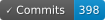
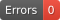

# Pop101 README template

A starting point for my project READMEs and a home for GitHub Actions badge experiments.

## Table of Contents

- [Overview](#overview)
- [Technologies](#technologies)
- [README layout](#readme-layout)
- [Badge gallery](#badge-gallery)

## Overview

Lead with the job the project does and the quickest way to see it work. Use the project's own artwork and keep screenshots of the actual product separate from the cover.

## Technologies

- [GitHub Actions](https://github.com/features/actions) runs the badge jobs.
- [Bash](https://www.gnu.org/software/bash/) collects repository stats.
- [CodeQL](https://codeql.github.com/) handles the existing code analysis.

## README layout

1. **Title, purpose, and try/install link.** One sentence should make the project clear.
2. **Badges and cover art.** Use badges that tell readers something, then add the project cover above the Table of Contents.
3. **Table of Contents, Overview, and Technologies.** Link each technology to its project or documentation.
4. **Getting Started and Usage.** Use the real entry point and a small example. Put known limitations next to the relevant steps.
5. **Product images.** Show a real app run where applicable, and link a high-resolution landing-page capture for websites.

## Badge gallery

These are examples from the [existing badge workflow](.github/workflows/build_with_badges.yml). Pick the useful ones rather than copying the whole gallery into every README.
